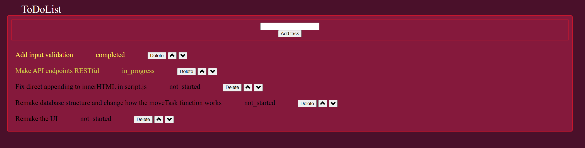

## Todo app
A simple web-based to-do list app built with Python, Flask, SQLite and Javascript. The application allows users to manage tasks, track their progress, reorder tasks, and customize the interface with different color themes.

